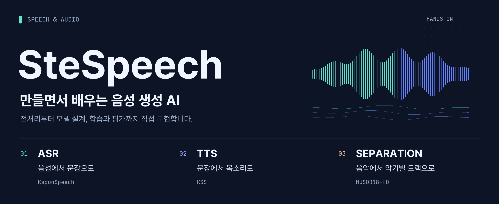
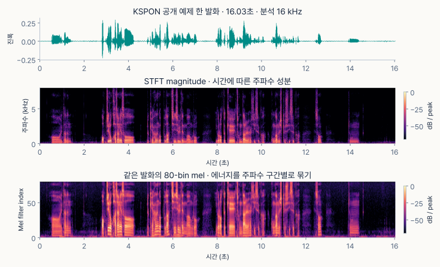
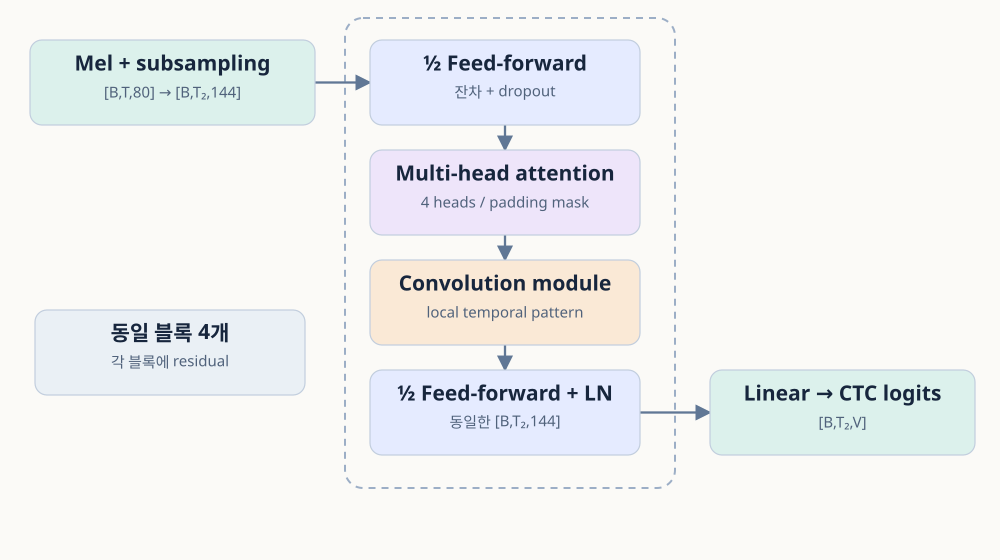
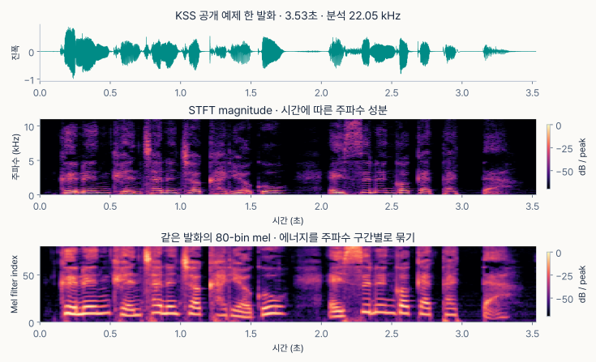
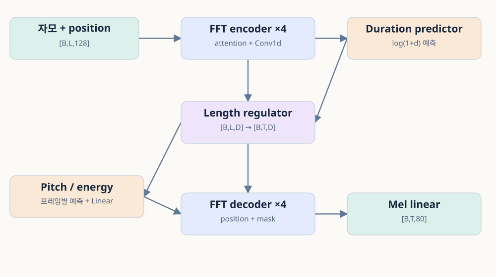
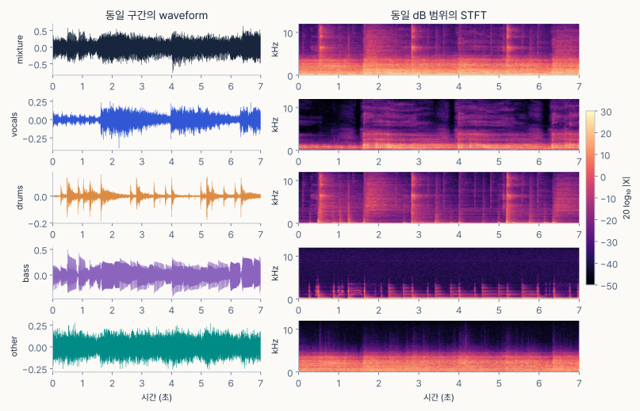
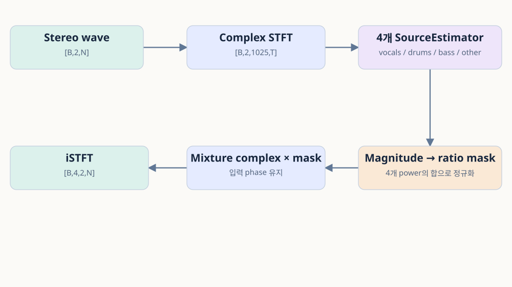

<p align="center">
  
</p>

<p align="center">
  <b><a href="../lecture/SteSpeech-KO.pdf">한국어 강의록 · PDF</a></b> &nbsp; / &nbsp;
  <a href="../code">모델 코드</a> &nbsp; / &nbsp;
  <a href="#시작하기">시작하기</a> &nbsp; / &nbsp;
  <a href="#커리큘럼">커리큘럼</a>
</p>

음성을 문장으로, 문장을 목소리로, 음악을 악기별 트랙으로 바꾸는 과정을 **PyTorch 코드로 직접 구현**합니다. 전처리와 텐서의 형태부터 모델 구조, 손실 함수, 학습 루프, 평가 지표까지 하나씩 연결합니다.

## 세 가지 실습

| | 01 · ASR | 02 · TTS | 03 · 악기 분리 |
| :--- | :--- | :--- | :--- |
| **문제** | 음성 → 문장 | 문장 → 음성 | 음악 → 4개 stem |
| **데이터** | KsponSpeech | KSS | MUSDB18-HQ |
| **모델** | Conformer + CTC | FastSpeech 2 + HiFi-GAN | Open-Unmix 계열 BiLSTM |
| **핵심 개념** | 정렬, CTC, 디코딩 | duration, F0, mel, vocoder | magnitude, mask, 위상, overlap-add |
| **평가** | CER · WER · RTF | 발음·운율·청취 설계 | SI-SDR · source별 분석 |
| **코드** | [asr.py](../code/asr.py) | [tts.py](../code/tts.py) · [vocoder.py](../code/vocoder.py) | [separation.py](../code/separation.py) |

> **현재 구현 상태** — 학습·평가·추론 코드를 포함합니다. GPU에서 합성 입력의 forward, 손실 수식, 저장·복원과 입출력 경로를 검증했습니다. 실제 데이터셋 학습·성능 평가는 아직 실행하지 않았으며, 학습된 가중치는 제공하지 않습니다. [검증 기록 보기](../lecture/verification.json)

## 실제 신호와 모델을 함께 읽습니다

파형과 스펙트로그램은 소량의 공개 예제로 만들었습니다. 아래 구조도는 해당 구현을 설명하며, 원 논문과 다른 설정은 강의록에 구분해 적었습니다.

<table>
<tr>
  <td width="50%"><b>ASR · 한국어 음성이 특징으로 바뀌는 과정</b></td>
  <td width="50%"><b>Conformer · attention과 convolution의 결합</b></td>
</tr>
<tr>
  <td><a href="../lecture/figures/kspon_speech.svg"></a></td>
  <td><a href="../lecture/figures/conformer.svg"></a></td>
</tr>
<tr>
  <td><b>TTS · 목소리의 파형과 주파수 구조</b></td>
  <td><b>FastSpeech 2 · 길이와 운율을 거쳐 mel까지</b></td>
</tr>
<tr>
  <td><a href="../lecture/figures/kss_speech.svg"></a></td>
  <td><a href="../lecture/figures/fastspeech2.svg"></a></td>
</tr>
<tr>
  <td><b>악기 분리 · mixture와 네 stem의 관계</b></td>
  <td><b>분리 모델 · 스펙트럼에서 mask와 파형으로</b></td>
</tr>
<tr>
  <td><a href="../lecture/figures/music_stems.svg"></a></td>
  <td><a href="../lecture/figures/separator.svg"></a></td>
</tr>
</table>

공개 예제는 강의용 그림에만 사용합니다. 전체 학습용 데이터셋은 포함하지 않습니다. [예제 출처와 파일 해시](../lecture/media/provenance.json) · [설명 그림 전체 보기](../lecture/figures)

## 커리큘럼

**기초 → ASR → TTS → 악기 분리 → 실험 설계** 순서로 진행합니다. 각 챕터는 학습 목표, 이론·수식, 그림, 실제 코드, 연습 문제와 참고 문헌을 연결합니다.

| 챕터 | 배울 내용 | 연결 코드 |
| :--- | :--- | :--- |
| **00–03 · 기초** | 실행 환경, 디지털 오디오, STFT·mel, 가변 길이 텐서 | [audio.py](../code/audio.py) · [data.py](../code/data.py) |
| **04–09 · ASR** | KsponSpeech 전처리, CTC, Conformer, 디코딩, 학습, 평가 | [asr.py](../code/asr.py) |
| **10–15 · TTS** | KSS, 자모·정렬·운율, FastSpeech 2, HiFi-GAN, 학습, 청취 평가 | [tts.py](../code/tts.py) · [vocoder.py](../code/vocoder.py) |
| **16–21 · 악기 분리** | MUSDB18-HQ, mask·위상, BiLSTM, 긴 음악 처리, 학습, 평가 | [separation.py](../code/separation.py) |
| **22 · 다음 실험** | 발전 모델과 실험 설계 | [강의록](../lecture/SteSpeech-KO.pdf) |

<details>
<summary><b>전체 목차 펼치기</b></summary>

| 번호 | 제목 | 번호 | 제목 |
| :--- | :--- | :--- | :--- |
| 00 | 전체 과정과 실행 환경 | 12 | FastSpeech 2 직접 설계 |
| 01 | 파형과 디지털 오디오 | 13 | HiFi-GAN vocoder |
| 02 | STFT·mel·파형 복원 | 14 | TTS·vocoder 학습 |
| 03 | 가변 길이와 텐서 계약 | 15 | TTS 평가와 청취 설계 |
| 04 | KsponSpeech 전처리 | 16 | MUSDB18-HQ 데이터 계약 |
| 05 | CTC 정렬과 확률 | 17 | 마스크와 위상 |
| 06 | Conformer-CTC 직접 설계 | 18 | 스펙트럼 분리 모델 |
| 07 | CTC 디코딩 | 19 | 긴 음악과 overlap-add |
| 08 | ASR 학습 루프 | 20 | 분리 모델 학습 |
| 09 | ASR 평가 | 21 | 분리 평가의 정의 |
| 10 | KSS와 한국어 TTS 입력 | 22 | 발전 모델과 실험 설계 |
| 11 | 정렬·duration·운율 특징 | | |

</details>

## 시작하기

### 1. 강의록 열기

[**만들면서 배우는 음성 생성 AI · 한국어 PDF**](../lecture/SteSpeech-KO.pdf)를 먼저 읽으시면 됩니다. 저장소를 내려받은 뒤에는 [HTML 강의록](../lecture/SteSpeech-KO.html)도 로컬 브라우저에서 열 수 있습니다.

### 2. 코드와 실행 명령 살펴보기

```bash
git clone https://github.com/scpark20/SteSpeech.git
cd SteSpeech
python3 scripts/ste_speech.py --help
```

`--help`는 Python 표준 라이브러리만 사용하며, 모델 로딩이나 학습을 시작하지 않습니다. 도움말 실행은 로컬에서 확인했습니다.

| 명령 | 역할 |
| :--- | :--- |
| `prepare-asr` | 기존 KsponSpeech 파일과 전사 목록을 manifest로 변환 |
| `prepare-kss` | KSS 문장·자모 정렬·운율 특징 준비 |
| `prepare-musdb` | MUSDB18-HQ mixture와 stem 경로 준비 |
| `train` | 선택한 모델 학습과 checkpoint 저장 |
| `evaluate` | checkpoint와 지정 split으로 평가 |
| `infer` | checkpoint로 문장 또는 오디오 출력 |

### 3. 모델 실행 환경 준비

검증 환경은 **PyTorch 2.9.1 + CUDA 12.8 · RTX 5090**입니다. 패키지 버전은 [scripts/requirements.txt](../scripts/requirements.txt), 데이터 형식과 작업별 명령은 [실행 안내](../lecture/runbook.json)에 있습니다. 새 환경의 패키지 설치는 아직 검증하지 않았습니다.

실제 학습에는 각 데이터셋과 split 구성이 필요합니다. **KSS는 자모 토큰과 mel 프레임 수에 맞는 검증된 duration 정렬 자료가 추가로 필요합니다.** 추론에는 학습된 checkpoint를 사용합니다.

## 코드 읽는 순서

| 위치 | 읽을 내용 |
| :--- | :--- |
| [code/audio.py](../code/audio.py) | 오디오 입출력, resampling, STFT, log-mel, F0·energy |
| [code/data.py](../code/data.py) | 전처리, vocabulary, manifest, Dataset, collate |
| [code/asr.py](../code/asr.py) | Conformer-CTC와 greedy·prefix beam 디코딩 |
| [code/tts.py](../code/tts.py) · [code/vocoder.py](../code/vocoder.py) | 음향 모델, length regulator, 파형 생성기와 판별기 |
| [code/separation.py](../code/separation.py) | 네 source 모델, mask, 긴 오디오의 분할·복원 |
| [code/engine.py](../code/engine.py) · [code/metrics.py](../code/metrics.py) | 학습·추론·저장·복원과 평가 지표 |
| [scripts/ste_speech.py](../scripts/ste_speech.py) | 모든 실습을 실행하는 CLI |
| [scripts/verify.py](../scripts/verify.py) | 학습 없이 합성 입력으로 수행하는 구조 검증 |

## 함께 읽는 논문

| 주제 | 논문 |
| :--- | :--- |
| 정렬 없는 음성 인식 | [CTC — Graves et al., 2006](https://www.cs.toronto.edu/~graves/icml_2006.pdf) |
| attention과 convolution | [Conformer — Gulati et al., 2020](https://arxiv.org/abs/2005.08100) |
| 길이와 운율을 예측하는 TTS | [FastSpeech 2 — Ren et al., 2020](https://arxiv.org/abs/2006.04558) |
| mel에서 파형으로 | [HiFi-GAN — Kong et al., 2020](https://arxiv.org/abs/2010.05646) |
| 음악 분리 모델 | [Open-Unmix — Stöter et al., 2019](https://sigsep.github.io/open-unmix/details.html) |
| 분리 평가의 정의 | [SDR — Half-Baked or Well Done? — Le Roux et al., 2019](https://arxiv.org/abs/1811.02508) |

강의의 전체 참고 문헌과 챕터별 연결은 [강의 소스](../lecture/course.py)에 있습니다. 예제 음원과 폰트에는 각 원저작물의 이용 조건이 적용됩니다.
